# Corgi · PR review for Herdr

<h3 align="center">AI-guided pull request review for Herdr. A walkthrough takes you through the PR risk first, with an architecture map of the change, its security blast radius and a GitHub-style diff you comment on and submit from.</h3>

<p align="center">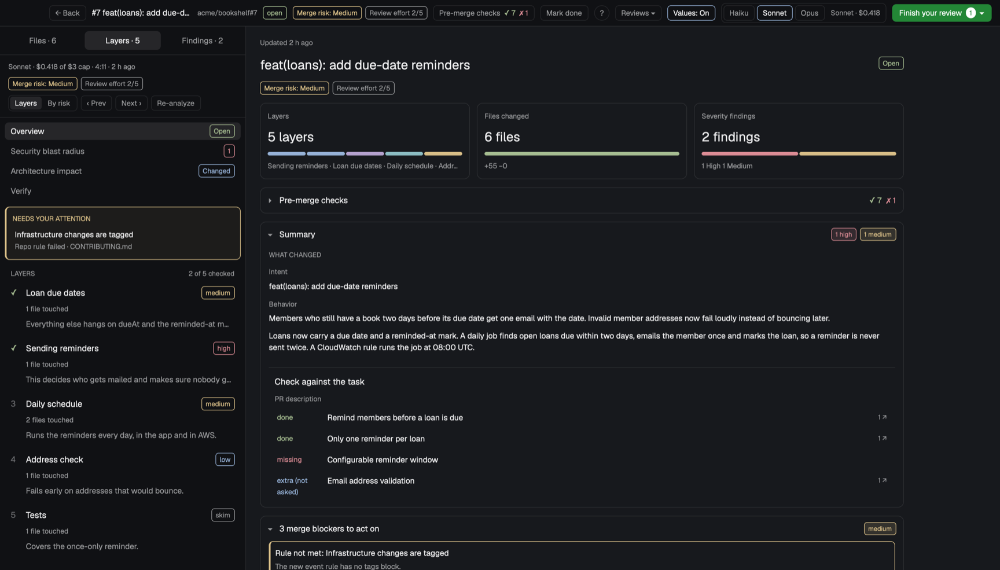</p>

<p align="center"><sub>✓&nbsp;Free,&nbsp;MIT &nbsp;·&nbsp; ✓&nbsp;Runs&nbsp;locally &nbsp;·&nbsp; ✓&nbsp;herdr-app&nbsp;0.1.14+</sub></p>

Part of [Corgi](https://github.com/saefty/herdr-corgi), a set of Herdr mods that plug into each other.

A Herdr mod for reviewing pull requests next to your agents. A side panel shows the focused branch's diff (or any
PR), lets you comment on lines and send the comments to the agent that wrote the code. A full-window review
layout adds an AI analysis that walks you through the PR by risk and layer, reviewers (Claude code review,
security review, optionally Codex) whose findings you can send to the agent to fix and then verify, an
architecture picture, a security blast radius, CI checks, related PRs, and go-to-definition in the diff. You comment
as on GitHub: a comment box under the line, pending comments as threads, and "Finish your review" posts one GitHub
review (Comment, Approve or Request changes) or sends it to the agent session.

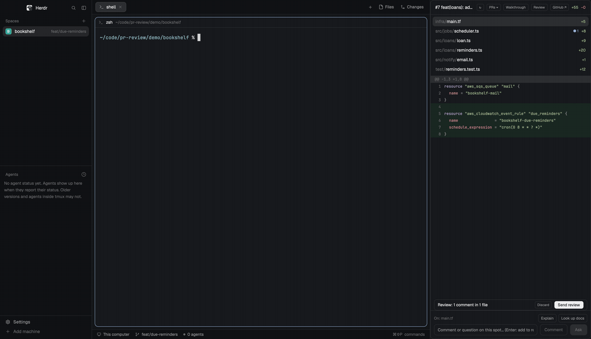

| | |
|---|---|
| 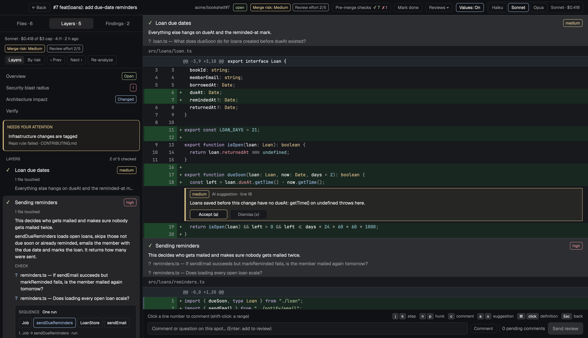 | 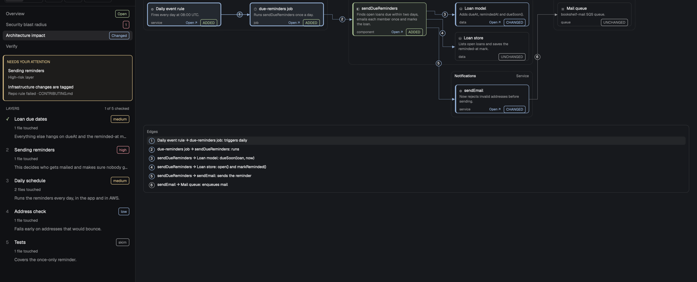 |
| 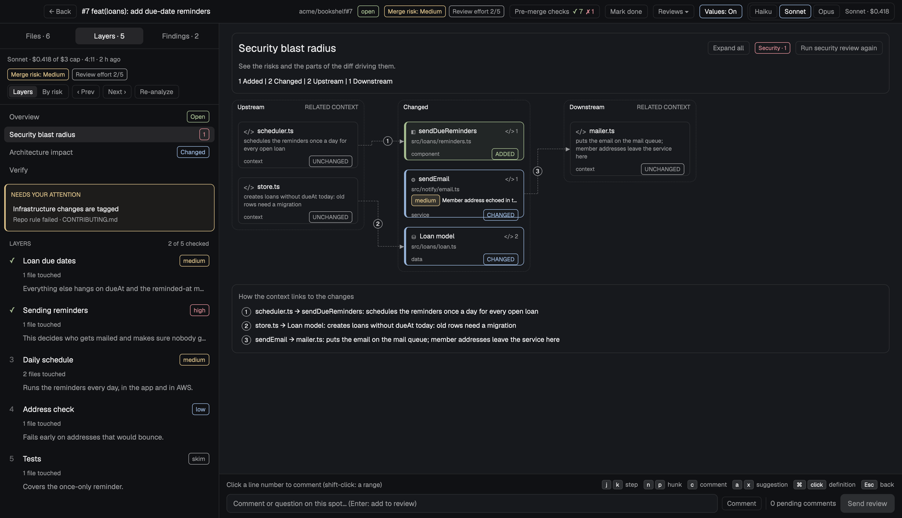 | 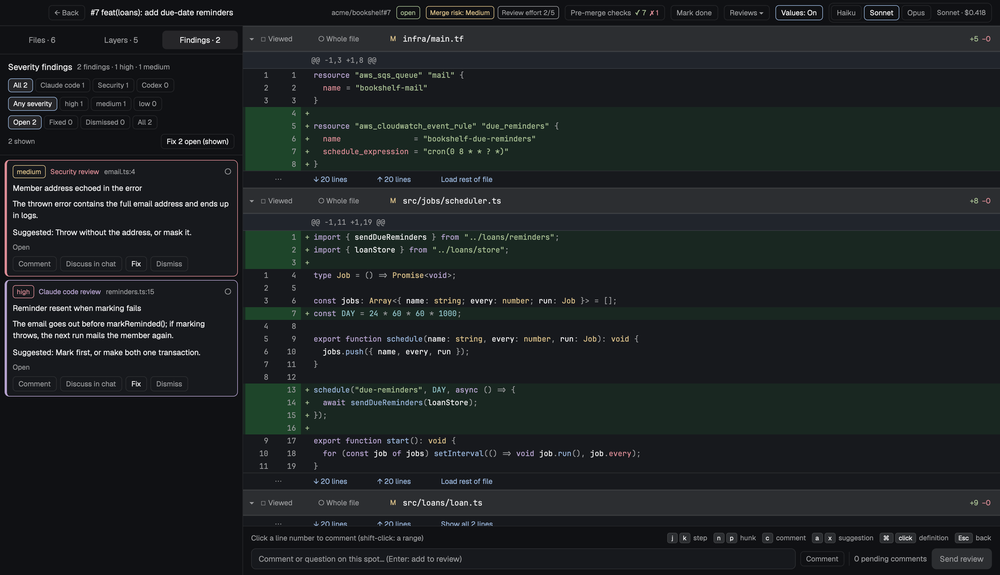 |
| 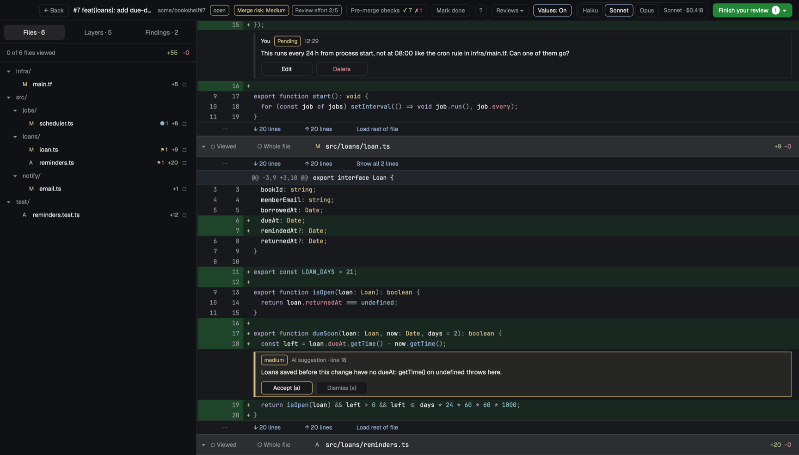 | 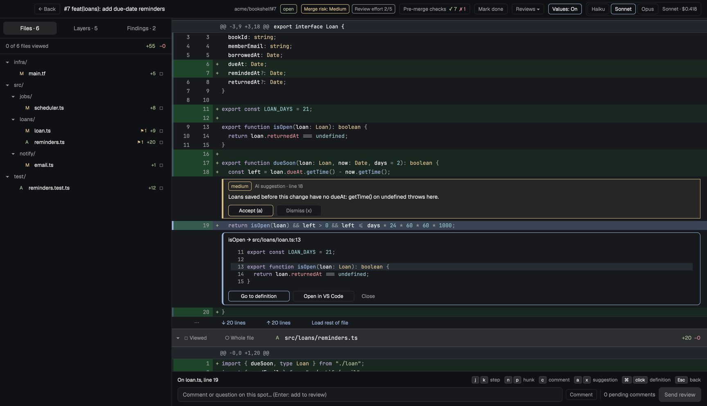 |
| 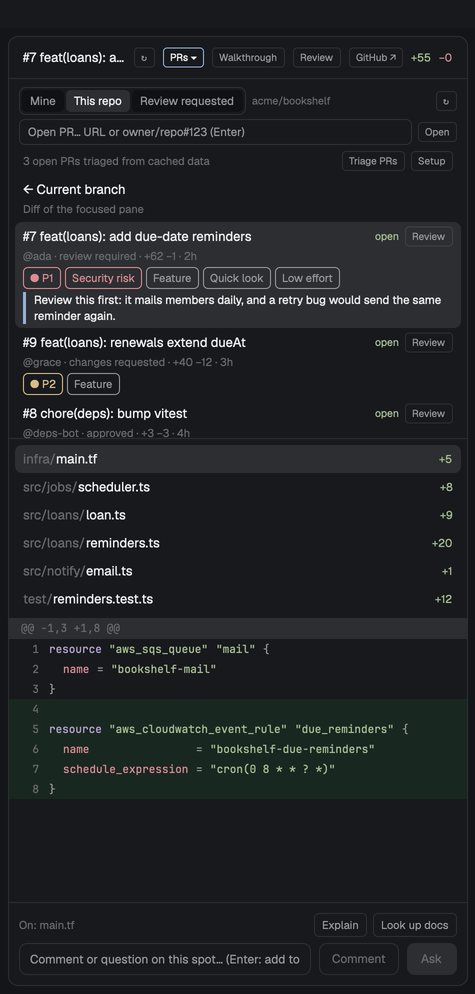 | 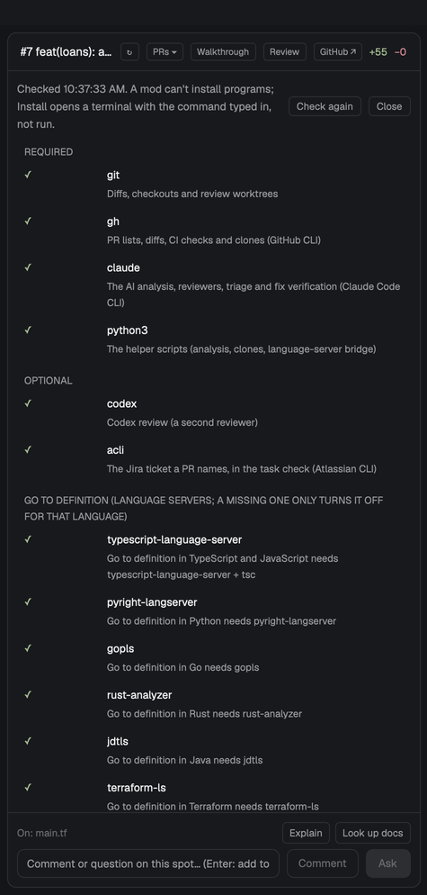 |
| 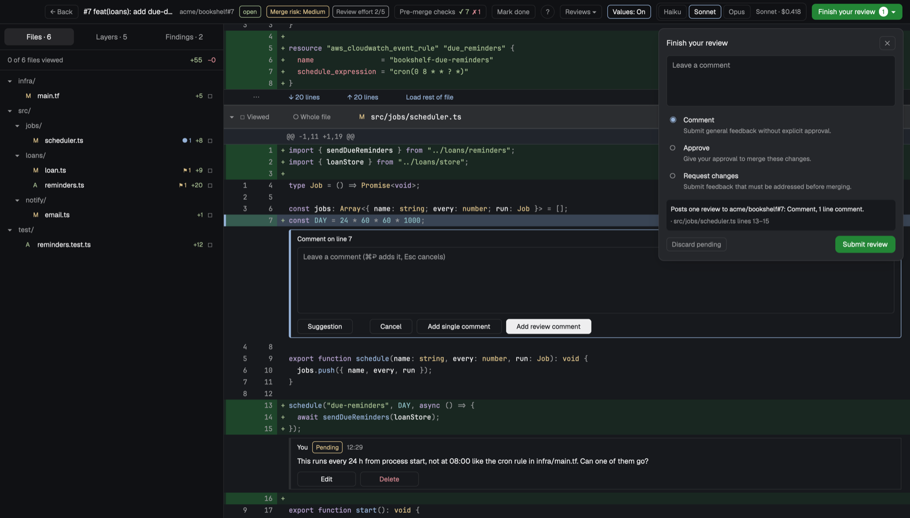 | |

The screenshots show an invented demo project (`demo/`), not a real repository.

## Use cases

- **Your agent opened a PR.** It shows up in the panel with the session that made it. You read the diff, comment on
  lines, and send the comments back to that agent, which picks up where it left off.
- **A colleague asked you for a review.** Pick it under *Review requested*, open it full size, and let the AI walk
  you through it: what the PR wants, how behaviour changes, which layer to read first and why. Comment on lines
  and post all comments as one GitHub review with Comment, Approve or Request changes.
- **A big PR lands on a Friday.** The overview gives you merge risk, review effort, blockers and failed checks
  before you open a file. The layers group 40 files into five steps you can tick off.
- **The author pushed again.** You see only what changed since your last review, and one click re-analyses just
  that part.
- **You want a second opinion.** Run a Claude code review, a security review or Codex. Findings land on their lines;
  send one to the agent with *Fix*, then *Verify* checks the new commit.
- **You don't know the codebase.** Hover a name or ⌘-click it to read its definition, see example values next to
  the changed lines, and look at the architecture picture to see which services the change touches.

## Features

- Panel: PRs from your sessions, the repo you're in, or review requests, with a one-line triage per PR.
- Review layout: overview (intent, behaviour, risk, effort, blockers, pre-merge checks), layers in risk or reading
  order with check questions, an architecture impact diagram, a security blast radius, and related PRs.
- Diff: syntax highlighting, go-to-definition through real language servers, inline example values, collapsed
  context you can open.
- Comments as on GitHub: click a line number (shift-click for a range) or press `c` for a comment box under the
  line, with Suggestion, Add single comment and Start a review. Pending comments show as threads under their lines
  and survive restarts; GitHub's existing review comments show there too.
- Finish your review: a summary, Comment / Approve / Request changes, and a preview of what goes out. It posts one
  GitHub review with all pending comments, or sends them to the PR's agent session when it has one. Comments on
  lines outside the diff go into the review body.
- Reviewers: Claude code review, security review, Codex (when installed), each finding with Discuss, Fix and Verify.
- Incremental: "since your last review" view and analysis.
- Model per review (Haiku, Sonnet, Opus); LLM calls only on click.
- Restricted Mode for other people's code (see below).
- Works with other mods: separate setups (accounts, clone folders), the Go to box and the chat bar.

## Works with

PR review, [Go to](https://github.com/saefty/herdr-corgi-goto) and the [chat bar](https://github.com/saefty/herdr-corgi-chatbar) each work alone. Installed together, they plug into each other:

- With **Go to** (⌘⇧P), paste a PR link or type `repo#123` and pick "Review PR"; reviews you started are searchable as "Resume review".
- With the **chat bar**, Discuss opens the agent's chat bubble so you can follow its answer without leaving the review.
- **Separate setups**, like work and personal: a small mod of your own can give each its accounts, clone folder and environment, and the panel shows each setup's PRs with its own tag.

## What's in here

- `mods/pr-review/`: the mod (the panel, and the review layout's two parts). `review-layout.json` is the review
  layout; the mod copies it to `layouts/review.json` the first time you open a review.
- `RECIPE.md`: the brief to build it from scratch.

## Requirements

A mod can't install programs. The panel's **Setup** (PRs ▾ → Setup, and by itself on first open when something
required is missing) checks each one, says what it enables, and opens a terminal with the install command typed
in but not run.

| Program | Needed for | macOS | Linux |
|---|---|---|---|
| `git` | diffs, checkouts | `brew install git` | `sudo apt install git` |
| `gh` (logged in) | PR lists, diffs, CI checks, clones | `brew install gh`, `gh auth login` | `sudo apt install gh` |
| `claude` (logged in) | the AI analysis, reviewers, triage, fix checks | `npm install -g @anthropic-ai/claude-code` | same |
| `python3` | the helper scripts (standard library only) | `brew install python` | `sudo apt install python3` |
| `codex` (optional) | the Codex reviewer, offered only when installed | `npm install -g @openai/codex` | same |
| `acli` (optional) | the Jira ticket a PR names, in the task check | `brew tap atlassian/homebrew-acli && brew install acli` | see Atlassian's docs |

Optional language servers turn on go-to-definition and hover for their language; a missing one only turns it off
for that language: `typescript-language-server` + `tsc` (TypeScript, JavaScript), `pyright-langserver` (Python),
`gopls` (Go), `rust-analyzer` (Rust), `jdtls` (Java), `terraform-ls` (Terraform), `clangd` (C, C++).

The reviewers use Claude Code's `/security-review` and a `/code-review` command; without the command in your
Claude setup the same review runs as a plain prompt.

## Install in three steps

<table>
<tr>
<td align="center" valign="top" width="33%"><h3>1</h3><b>Add the mod</b><br /><sub>With <a href="https://github.com/saefty/herdr-corgi">Corgi</a>: <code>corgi enable pr-review</code>. By hand: copy <code>mods/pr-review</code> to <code>~/.config/herdr-app/mods/</code>. There are no keys to merge.</sub></td>
<td align="center" valign="top" width="33%"><h3>2</h3><b>Check it</b><br /><sub>Corgi does this for you. By hand: <code>herdr-app check ~/.config/herdr-app/mods/pr-review</code>.</sub></td>
<td align="center" valign="top" width="33%"><h3>3</h3><b>Open a PR</b><br /><sub>The panel docks on the right. Its Setup says which programs are missing; then pick a PR and press Review.</sub></td>
</tr>
</table>

Or tell your agent: `Read ~/.config/herdr-app/AGENTS.md, then add this mod: https://github.com/saefty/herdr-corgi-pr-review/tree/main`

By hand, step by step: copy `mods/pr-review` to `~/.config/herdr-app/mods/`, then run
`herdr-app check ~/.config/herdr-app/mods/pr-review`.
The panel docks on the right the first time Herdr sees it. The review layout appears on first use: the first
"Review" click writes it to `layouts/review.json` (or `layouts/pr-review.json` when you already have a different
layout named `review`). It never overwrites a file you have.

It runs programs (`git`, `gh`, `claude`, `python3`, language servers), reaches GitHub through `gh` (it posts only
when you click Submit review or Add single comment), and reads your
Claude session transcripts (`~/.claude/projects`) to list PRs your sessions created. LLM calls only happen when you
click (Analyze, a reviewer, Triage, Verify fixes). Its data lives in `~/.config/herdr-app/pr-data/`.

## Settings

Optional, in `~/.config/herdr-app/pr-review.config.json`:

```json
{ "language": "English", "cloneRoot": "~/code", "globalRules": "PR titles follow Conventional Commits.", "ledger": null, "dryRun": false }
```

`language` is what the AI writes in; `cloneRoot` is where PR checkouts are cloned on request; `globalRules` are
conventions every PR is checked against; `ledger` is a folder for a JSONL usage ledger of every LLM call; `dryRun`
makes "Submit review" write the GitHub payload to `pr-data/review-dry-run.json` instead of posting it.

## Customize

Without touching code:

- **What the AI writes and checks:** `language`, `globalRules` (conventions every PR is checked against) and the
  other keys in `pr-review.config.json` (above).
- **Which model:** Haiku, Sonnet or Opus, picked per review in the review layout.
- **The review layout:** `layouts/review.json` is yours once it is written. Move, resize or remove its blocks; the
  mod never overwrites it.
- **Your own code review:** with a `/code-review` command in your Claude setup, the Claude reviewer uses it.
- **Separate setups** (accounts, clone folders, environment) from a small mod of your own; see Plug-ins.

Changed the code itself? Your edits survive `corgi update`: Corgi merges your version, the old release and the new
one. `corgi diff pr-review` shows what you changed, and `corgi resolve pr-review` helps when an update and your edit
touch the same lines.

## Plug-ins

Other mods can add setups (groups of PRs with their own tag, environment, clone folder and view filter), show the
review list somewhere else, and work with Go to and a chat bar. For mod authors, the details are in
[PROVIDERS.md](mods/pr-review/PROVIDERS.md).

## Demo

`sh demo/setup.sh` builds an invented repo (`acme/bookshelf`, PR #7 "feat(loans): add due-date reminders") with a
local stand-in for its GitHub remote, and a separate Herdr home in `demo/home` whose pr-review data is seeded from
`demo/fixtures/` (the analysis, two findings, related PRs and checks, PR lists, triage). Open a second Herdr window
on it with `HERDR_APP_HOME="$PWD/demo/home"`, add a space in `demo/bookshelf` there, and switch it to the `review`
(or `demo-panel`) layout: everything shows without LLM calls, and GitHub is only asked when a seeded PR list is
older than 3 minutes (↻). The commands `pr-review.page:arch`, `pr-review.step:1`,
`pr-review.def:<path>:<line>:<name>`, `pr-review.source:repo` and `pr-review.setup` drive it from
`herdr-app do`, and `pr-review.comment:<path>:<line>` and `pr-review.finish` open the comment box and the
Finish-your-review popover. The demo config sets `"dryRun": true`, so Submit review posts nothing.

## Tests

`cd mods/pr-review && for f in test_*.mjs; do node $f; done && for f in test_*.py; do python3 $f; done`
(no network; `LIVE=1 node test_defs.mjs` also asks pyright).

## Restricted Mode

Language servers can run code from the repo they index: Gradle and Maven build scripts, Rust build scripts and proc
macros, a toolchain or cargo config, a TypeScript copy in node_modules. pr-review trusts your own branches, PRs from
your sessions and PRs you authored. For anyone else's PR it asks first, as VS Code does when you open a folder:

- **Trust this PR** or **Trust all PRs in owner/repo**: language servers run as usual.
- **Stay in Restricted Mode**: Java skips the build import, TypeScript uses your global install, Go downloads nothing
  and skips cgo, and rust-analyzer doesn't start. Go-to-definition finds less. The diff, comments and reviews, the
  reviewers and the AI analysis work the same.

The header shows **Restricted Mode · Trust** until you trust the PR.
