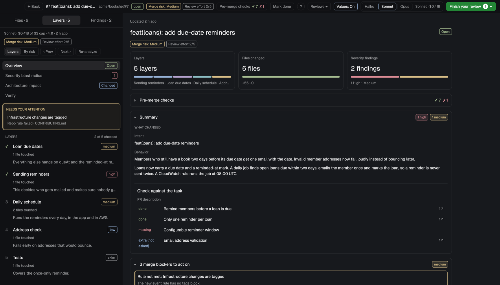

# Corgi · PR review

AI-guided pull request review for Herdr. Instead of a wall of files, you get the change as a story: grouped into layers by intent and ordered risk first, an architecture map of which components changed and how they connect, and a security blast radius of what calls into the change. In the diff, debugger-style sample values sit next to the changed lines, so you see what flows in and out of a function without running it. Comment on lines like on GitHub and submit one review, or send the findings to the agent that wrote the code.

On the right of the window, a panel shows the diff of the focused space's
branch against its PR base (or any PR you pick) with comments on lines that go to the agent who wrote the code.
"Review" switches to a full-window layout: the AI's walkthrough of the PR in layers on the left, every diff line
on the right with suggestions, reviewer findings and comments inline, and pages for the overview, the security
blast radius, the architecture impact and fix verification.

## What you see

**The panel** (`mods/pr-review`, no props; docks right, 380 px), theme colors throughout, a card with 10 px
corners and a 1 px `border`:

- Header, 42 px: the PR title (`#42 feat(invites): …`, semibold, truncated) or `vs origin/main`; small pills
  (10 px text, 4 px corners, `border`, `muted` text, `foreground` on hover): `↻`, `PRs ▾`, `Walkthrough`,
  `Review`, `GitHub ↗`; then `+N` in `ansi2` and `−N` in `ansi1`.
- A red-tinted banner (`ansi1` at ~11 % alpha) "Needs gh, claude to work. [Open Setup]" when a required program is
  missing or logged out.
- **IN PROGRESS** (11 px semibold `muted` caps): up to 6 started reviews, each `#n title` (12.5 px), a line like
  `1/10 steps · 1/17 files · 1 comment · 3 h ago` (11 px `muted`), a context tag when a plug-in supplies several
  contexts, and `Resume`.
- A yellow banner (`ansi3` ~11 %) "This PR belongs to …" with `Switch to …` and `Clear` when the picked PR's
  context is hidden by the current view.
- `PRs ▾` opens a 360 px list: source tabs `Mine` (PRs your Claude sessions created) / `This repo` / `Review
  requested`, an "Open PR… URL or owner/repo#123" field, a `Triage PRs` and a `Setup` pill, then rows: title,
  state (`open` `ansi2`, `draft` `dim`, `merged` `ansi5`, `closed` `ansi1`), a `Review` pill, a second line
  (repo · session title, or @author · review decision · +/− · age) and triage chips (`● P1` in `ansi1`, `P2`
  `ansi3`, `P3` `muted`; "Security", "Deep review", …) with the "why" in an accent quote bar on the picked one.
- The file list (28 px rows, up to 200 px): folder dimmed, file name, `● n` comments in `accent`, `+/−`.
- A Diff / File toggle and `VS Code ↗` for the open file; File shows the file in a read-only editor (markdown
  rendered).
- The diff: 20 px rows in the terminal font at 11 px, line number in `dim`, added rows on `#2ea0431a`, removed on
  `#f851491a`, syntax colors from the theme's ANSI colors; comments as small cards under their last line.
- A "Review: 2 comments in 1 file" bar with `Discard` and a solid `Send review` button.
- The ask box: "On: file line 12", presets `Explain` and `Look up docs`, an input, `Comment` and a solid `Ask`.
- **Walkthrough** replaces the diff with the AI analysis in reading order, one step at a time.
- **Setup** replaces the diff with three groups (Required, Optional, Go to definition): each program with ✓ in
  `ansi2`, `missing` in `ansi1`, `not installed` in `muted` or `logged out` in `ansi3`, what it enables
  ("Go to definition in Java needs jdtls"), the install command in mono, `Copy` and `Install in terminal`.

**The review layout** (`mods/pr-review/review-layout.json`, written to `layouts/` on first use): a column, no system
title bar (traffic lights at 12, 16):

- The bar (52 px, `chrome`, draggable; the mod with `{part: "bar"}`, left padding 84 px): `← Back`, `#n title`
  (14 px semibold), `owner/repo#n`, a state badge, a context tag (only with several contexts), merge risk and
  review effort badges, `Pre-merge checks ✓ n ✗ n`, `Mark done`, a round `?` (the keys popup), `Reviews ▾`,
  `Values: On`, the model picker (Haiku / Sonnet / Opus) and the shown analysis' model and cost (it truncates first
  when the window is narrow), and at the right GitHub's green (`#238636`) `Review changes ▾`, which reads
  `Finish your review (n) ▾` while n comments are pending.
- The body (`{part: "review"}`): a 420 px left column with tabs `Files · n`, `Layers · n`, `Findings · n`.
  Layers: model, cost and age; merge risk and effort; `Layers / By risk`, `‹ Prev`, `Next ›`, `Re-analyze`;
  pages Overview, Security blast radius, Architecture impact, Verify; a yellow "Needs your attention" box; the
  layers (✓ when checked, title, risk badge `high` `ansi1` / `medium` `ansi3` / `low` `ansi4` / `skim` `muted`,
  "n files touched", why it matters; the current one expanded with explanation, check questions and flow cards
  with example inputs and outputs).
- On the right one virtual list of 22 px rows: the step header, then each hunk with old/new line numbers,
  `+` rows tinted `#2ea043`, `−` rows `#f85149`, and cards inline: AI suggestions (`Accept (a)`, `Dismiss (x)`)
  and findings (severity badge, reviewer in its color, `Comment`, `Discuss in chat`, `Fix`, `Dismiss`).
- Commenting as on GitHub's "Files changed": hovering the line numbers shows a `+`. The composer is two list rows
  under the selection's last line (168 px and 48 px, `accent` border): "Comment on lines 13–15", a fixed-height
  textarea, then `Suggestion` (inserts a GitHub suggestion block with the selected lines), `Cancel`,
  `Add single comment` and a solid `Start a review` / `Add review comment`. A comment whose lines are outside the PR
  diff (opened context) gets the badge "not in the diff: will go into the review body". Pending comments show as
  threads under their last line: `You`, a `Pending` badge, the text, `Edit`, `Delete`. GitHub's own review
  comments on the PR show there too, read only.
- `Finish your review` opens a 460 px popover at the top right of the body: a summary textarea, radios
  `Comment` / `Approve` / `Request changes` with GitHub's descriptions, `Send to: GitHub | Agent session` (only
  when the PR has a session), a preview of what goes out ("Posts one review to owner/repo#n: Comment, 2 line
  comments, 1 in the body." and the lines), `Discard pending` and a green `Submit review`.
- **Architecture impact** and **Security blast radius**: groups as dashed frames of cards (title up to 2 lines,
  description up to 3, type, "Open ↗" to the code, a status chip: ADDED `ansi2`, CHANGED `accent`, UNCHANGED
  `muted`, REMOVED `ansi1`). Every call points left to right. Inside a group a node sits right of its caller, so a
  group can span columns. Groups whose columns overlap stack vertically (arch.js archLayout). Each call to the next
  column gets its own lane, an arrow and a numbered round badge, with a small hop where two unrelated lines cross.
  A call that would skip a column or close a cycle is a 16 px stub with a chip ("→ Target ⑭"). Hovering the chip
  highlights the target, and clicking it focuses the target. Three or more calls from one node into one group share
  one trunk that fans out in the group's left inset. Clicking a card focuses it: its lines and neighbours stay, and
  the rest drops to 25 % (hover: 55 %). A second click or Esc clears the focus. An orchestrator with `states` shows
  them as a lane in its card, and each state's call leaves at its row. An "Edges" list (blast radius: "How the
  context links to the changes", larger) has "① A → B: label" rows. Hovering a badge or row highlights that line.
  A Structural diff / Before / After toggle; the stats, legend and toggle wrap onto a second row when narrow.
- Sources: elements and intent/behavior statements may carry `source` (implemented with `evidence` file:line,
  existing in grey, spec dashed with a "spec" tag: only in the description or ticket). A legend row reads
  "Implemented · Existing · Spec only". "Check against the task" links to the spec-only elements it names.
- `↻ Refresh diagrams` (the page header) and `Refresh this view` (an expanded layer) run review.py in diagrams
  mode: one call ("Review diagrams") that redraws only the pictures for today's diff and merges them into the
  cached analysis. While it runs the button reads "Refreshing…". When it finishes, the pictures say "updated for
  <head>", or "diagrams from an older diff" when the head moved since.
- A layer can carry several `visuals`; more than two show as tabs. A `state_machine` is drawn top to bottom
  (arch.js stateLayout): a start dot, states by layer, an end ring. A choice forks into columns, and Parallel/Map
  branches sit side by side in their block. Transitions back go up a rounded return lane on the left. Self-loops
  are a small loop on the card edge. Catch/Retry are stubs to the right. Labels read "event [guard] / action".

**Added in 0.3:** the left column is resizable (560 px by default, 340 px to 65% of the window). The header has two
rows: the title and the actions (Fix selected, Run review, Finish your review), then risk, effort, checks, the model
dropdown, Values, help and a ⋯ menu. Comments are compact cards (a stripe in the source's colour, one header row, the
text, replies, Reply). The Architecture page has an Ask button, Fit, and a canvas that scrolls sideways by itself.
The Ask drawer sits at the right edge (380 px, foldable to a 28 px strip). A Comments tab sits next to Findings.
Explore shows Overview, Layers, Architecture and Files for a topic, without a diff.

## How it behaves

- Agent status isn't shown; agents are only targets: the panel's "Send review" and "Ask", the review layout's
  "Submit review" sent to the agent session, and "Fix" go to the PR's session
  agent if it is live, else `claude --resume <session>` in a new tab, else this space's agent, else a new
  `claude` tab, with the prompt as its task.
- Clicking a diff line selects it (shift-click a range); type and Enter adds a comment; `j/k` next/previous
  change, `n/p` file, `c` comment, Esc clears.
- In the review layout, a click on a line number (or `c` on the selected line) opens the composer there;
  shift-click extends it to a range. One composer at a time; focus goes into it; ⌘↩ adds the comment to the
  pending review, Esc cancels. `Add single comment` posts just that comment now. Pending comments are saved per PR
  (`pr-data/reviews.json`) and survive tab switches and restarts.
- `Submit review` to GitHub posts one review with all pending comments in a single
  `gh api -X POST repos/{owner}/{repo}/pulls/{n}/reviews --input -` (JSON on stdin, under the PR context's env):
  `commit_id` the PR head, `event` COMMENT / APPROVE / REQUEST_CHANGES, `body` the summary plus the comments outside
  the diff with their file and lines, `comments` `{path, line, side, start_line?, start_side?, body}`. Pending
  comments clear only on success; the popover then shows the review's URL with `Open`, on failure the error (with
  the line comments it tried). To the agent session the same review goes as one prompt with the verdict and
  summary. Default: the agent session when the PR came from one, else GitHub.
- `Review` switches to the review layout (and remembers the layout to come back to); `← Back` / Esc returns.
  The first time, the mod writes `review-layout.json` to `layouts/review.json`; when a `review` layout that isn't
  this mod's is already there, it uses `layouts/pr-review.json` instead. It never overwrites a file.
- The AI analysis never runs by itself: "Analyze with Sonnet" (or Haiku/Opus) starts it detached; a spinner shows
  the time and the cost cap; it can take minutes. After a push, "Only new changes" analyses just the new commits.
- `Reviews ▾` lists Claude code review, Security review and (when installed) Codex review with their last run;
  Run starts one in the background on a checkout of the PR head; findings appear inline and under Findings.
- `Fix` sends findings to the agent, which reports back per finding; after the next push "Verify fixes"
  checks them (fixed ✓, not fixed → open again, unclear).
- "Discuss in chat" pastes the finding into the agent's terminal in a floating window without sending it (or
  into a chat mod's bubble, PROVIDERS.md).
- The analysis writes in the `language` setting; prompts are English.
- Progress (checked layers, seen files, where you were) is kept per PR and restored on Resume.

**Added in 0.3:** Ask (one call, "Review: architecture question") answers with text, the cards and edges it is
about and file:line evidence; a short thread per PR is kept in pr-data/deep.json. Pin turns an answer into a private
note on its card, edge or lines; notes never go out. Show details (one call, "Review: drill down") draws a card or a
layer from the inside, cached per card path and diff head. Explore (one call, "Explore: walkthrough", read-only tools
in the repo) keeps the newest 20 explorations. Every send to an agent opens a preview first. Fix starts a sub-agent
(`hc run --parent <PR agent>`) in a worktree on fix/<pr>-<id> and tells the PR agent (`hc send`); the sub-agent's last
step is one `hc send` to the PR agent, which cherry-picks, tests and pushes; Apply to PR cherry-picks onto a clean checkout. The
GitHub submit posts only the ticked items. The analysis writes every hunk to its run folder with an index and splits
big PRs into cohort passes and a merge pass under one cap.

## Built from

- `mods/pr-review/review-layout.json` (installed as `layouts/review.json`): `root` column (`titlebar: "none"`,
  `traffic_lights: [12, 20]`, `resizable: false`, 1 px `border` divider) with `review-bar` (52 px, `window_drag`,
  `{mod: "pr-review", props: {part: "bar"}}`) and `review-body` (`{part: "review"}`).
- `mods/pr-review`: `main.js` (the panel; mixes in `review.js` for the layout parts and the `reviews` popup and
  `agentbar` window title), `pr.js` (pure: diff parsing, prompts, registry, triage, pre-merge checks),
  `arch.js` (pure: the diagram layout with lanes, ports, hops and badges), `stack.js` (diagram and card
  drawing), `syntax.js` (highlighting), `defs.js` + `lsp_bridge.py` (go-to-definition through language
  servers kept warm by one local bridge), `context.js` (optional contexts), `setup.js` + `setup-view.js`
  (Setup), and Python helpers: `prs.py` (PRs from Claude transcripts + `gh pr view`), `worktree.py` (a reusable
  checkout of the PR head), `review.py` (the analysis), `reviewers.py`, `verify.py`, `triage.py`, `related.py`
  (related PRs, CI checks, mergeability), `llm.py` (`claude -p` with a JSON schema and a budget cap, optional
  ledger).
- `herdr`: `exec`, `hc send`, `run` (`tab.new`, `tab.select`, `layout.switch`, `pane.focus`,
  `terminal.paste`), `openOverlay` (popup and window), `readTextFile` / `writeTextFile` (compare-and-swap),
  `watchFolder`, `shared` / `setShared`, `nextCommand` (`pr-review.page:arch`, `pr-review.step:n`, …).
- Programs: `git`, `gh`, `claude`, `python3`, optionally `codex`, `acli`, language servers, `code`.
- Data in `pr-data/` (cache bounded to 200 files / 50 MB); settings in `pr-review.config.json`.

## Watch out

- Every exec costs 0.3–0.5 s: diffs, PR info and repo facts are memoized; diffs are cached per head.
- The analysis can run 15 minutes, longer than `exec` waits: it runs detached and writes a status file the
  layout follows.
- `hc send` always presses Enter, so drafts go through the clipboard and `terminal.paste`.
- The virtual list takes clicks by x position (one handler per list); measure the mono font's character width.
  Its rows can't hold handlers or create state: the composer's `TextareaState` is made in init, its buttons are
  placed by x, and a press in the list doesn't take the keyboard while the composer is open.
- The bar and the body are two copies of the mod: the bar's button sends `pr-review.finish`, the body draws the
  popover and publishes the pending count in `review.meta`.
- Every row height is stated up front, so the composer's textarea has a fixed height (it scrolls inside).
- Diagram text heights are estimated (29 / 38 characters per line); cards clip to 2 + 3 lines with an ellipsis
  and show the whole text as a tooltip.
- A column with more than 7 cards keeps barycentre order only (no exhaustive crossing search).
- Without the Claude `/code-review` command the Claude reviewer runs as a plain prompt.
- Nothing installs programs: Setup only pre-types commands.

- Explore trusts a folder only when it is your github.com repo or you trusted it; anything else starts in Restricted
  Mode, like other people's PRs.
- The comment cards are rows of the diff's virtual list: their clicks are placed by x, so their header buttons sit at
  fixed positions.

## Demo data

`demo/fixtures/` holds a complete example in the real formats: `repo/base` and `repo/head` (the invented
`acme/bookshelf` before and after PR #7), `analysis.json` (the analysis answer as `review.py` returns it; hunk
references are written `@<path>` and `demo/seed.mjs` turns them into aliases), `findings.json`, `related.json`,
`prs.json`, `sources.json` and `triage.json`. `demo/setup.sh` builds the repo and a Herdr home from them;
`demo/layouts/demo-panel.json` shows the panel alone. Build against them before touching real PRs.

## Done when

- `herdr-app check mods/pr-review` passes and every `test_*.mjs` / `test_*.py` passes without network.
- In the demo (`"dryRun": true`), a click on a line number opens the composer under it, the seeded pending comment
  shows as a thread, and `Submit review` writes the payload to `pr-data/review-dry-run.json` instead of posting.
- The panel shows the focused branch's diff; a comment and "Send review" reach the space's agent.
- `PRs ▾ → This repo` lists the repo's open PRs; `Review` opens the layout on one; `← Back` returns.
- "Analyze" produces layers, an Architecture impact page where no line runs through a card and every connection
  has its badge and legend row, and a blast radius that says "No security review yet" before one ran.
- Setup lists every program with its state and "Install in terminal" opens a tab with the command typed in, not
  run.
